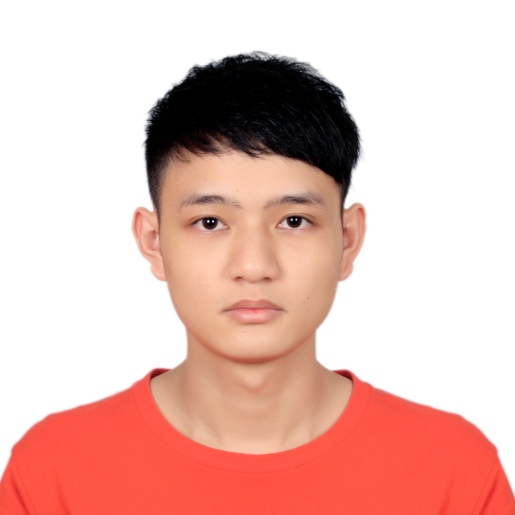

+++
title = 'A little about me'
description = 'Senior Machine Learning Engineer at Noteworthy AI. Computer vision, LiDAR processing, and explainable AI.'
+++

I’m Peijie, an ML engineer at Noteworthy AI. I work on computer vision for infrastructure inspection, taking models from training to deployment on edge devices and in the cloud. I also work with LiDAR, combining images and point clouds to locate assets and measure cable spans.

Before joining industry, I completed my Ph.D. at Auburn University with Prof. Anh Nguyen and Saad Bias. My research explored how to understand and explain what vision models learn. That led to projects like [PEEB](/project/peeb/), which recognizes birds through descriptions of their parts, and [gScoreCAM](/project/gscorecam/), which visualizes what CLIP is looking at.

Outside work, I enjoy movies and spending time with cats.

## Resume

[Download resume (PDF)](/uploads/Peijie_Chen_Resume.pdf)
